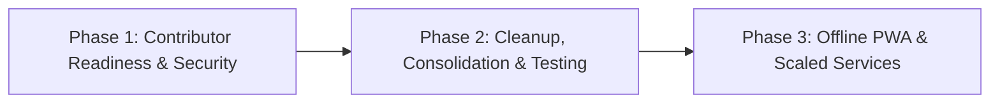

# Study Hub Backlog & Engineering Roadmap 📋🚀

This backlog contains prioritized tasks for incoming open-source contributors, organized by difficulty, alongside our GitHub label taxonomy and 3-phase roadmap.

---

## 🏷 GitHub Label Taxonomy

| Label | Color | Description |
| :--- | :--- | :--- |
| `good first issue` | `#7057ff` | Good for newcomers; self-contained task touching 1–2 files. |
| `help wanted` | `#008672` | Extra attention or community contribution needed. |
| `area:frontend` | `#1d76db` | Astro pages, React components, CSS, flipbook reader. |
| `area:backend` | `#5319e7` | Express API, routes, controllers, middleware. |
| `area:database` | `#d93f0b` | PostgreSQL schema, Supabase RLS, SQL migrations. |
| `area:ai` | `#b60205` | Google Gemini tutoring, OpenAI embeddings, pgvector. |
| `area:payments` | `#0e8a16` | Mobile Money verification, checkout flow, one-time downloads. |
| `area:content` | `#fbca04` | Study notes, past papers, UNEB syllabus indexing. |
| `area:docs` | `#0075ca` | Documentation, guides, README improvements. |
| `area:security` | `#e11d48` | Security hardening, input validation, authentication, privacy. |
| `bug` | `#d73a4a` | Something isn't working as expected. |
| `enhancement` | `#a2eeef` | New feature or improvement request. |

---

## 🐣 Good First Issues (12 Scoped Tasks)

### 1. `[GFI-01]` Automatic Fallback on Resource Catalog HTTP 402/500
- **Area:** `area:frontend`
- **Files to Touch:** `frontend/src/script/resources.js`
- **Task:** If the live Supabase catalog request returns HTTP 402 or 5xx, catch the error and load `public/study-hub-resources-1-catalog.json` instead of displaying an error state.
- **Acceptance Criteria:** Subject pages display resources even when Supabase catalog is unreachable.

### 2. `[GFI-02]` Fix Double Navigation Overflow on Mobile Library
- **Area:** `area:frontend`
- **Files to Touch:** `frontend/src/styles/astro-site.css`
- **Task:** Eliminate horizontal scrollbar on viewport widths under 400px on `/library.html`.
- **Acceptance Criteria:** Verified at 320px and 375px widths without horizontal overflow.

### 3. `[GFI-03]` Consolidate Footer Subject Directory Columns
- **Area:** `area:frontend`
- **Files to Touch:** `frontend/src/components/SiteFooter.astro`
- **Task:** The footer currently renders all 28 subject links in a tall column. Group them into expandable accordions or limit to 6 popular subjects with a "View All Subjects" link.
- **Acceptance Criteria:** Footer height reduced by >50% on mobile screens.

### 4. `[GFI-04]` Clean Up Unused `expree` and `mongoose` Dependencies
- **Area:** `area:backend`
- **Files to Touch:** `backend/package.json`
- **Task:** Remove unused dependencies (`expree`, `mongoose`, `cloudinary`) and delete dead `backend/database/config/mongo.js`.
- **Acceptance Criteria:** `npm ci` completes faster and `npm test` still passes 100%.

### 5. `[GFI-05]` Add Consent Checkbox to Mobile Money Checkout
- **Area:** `area:frontend`, `area:payments`
- **Files to Touch:** `frontend/src/pages/document-payment.astro`
- **Task:** Add a required checkbox: *"I consent to Study Hub processing my phone number for verifying this download under Uganda DPPA 2019."*
- **Acceptance Criteria:** Submit button remains disabled until checkbox is checked.

### 6. `[GFI-06]` Add Copy-to-Clipboard Action for Mobile Money USSD Code
- **Area:** `area:frontend`, `area:payments`
- **Files to Touch:** `frontend/src/pages/document-payment.astro`
- **Task:** Add a 1-click button to copy `*185#` and the receiver phone number with a visual toast confirmation.
- **Acceptance Criteria:** Successfully copies text on both desktop and mobile browsers.

### 7. `[GFI-07]` Add Reading Time Estimate to Subject Notes
- **Area:** `area:frontend`
- **Files to Touch:** `frontend/src/components/ResourceCard.jsx`
- **Task:** Calculate estimated reading time based on page count (e.g. `pages * 2 minutes`) and display a subtle badge.
- **Acceptance Criteria:** Badge appears on cards with known page counts.

### 8. `[GFI-08]` Add Dark Mode Reading Toggle to Flipbook Viewer
- **Area:** `area:frontend`
- **Files to Touch:** `full_page_flipbook_viewer/index.html`, `css/`
- **Task:** Persist user's preferred reading theme (Warm, Night, Sepia) in `localStorage`.
- **Acceptance Criteria:** Reloading reader retains selected color theme.

### 9. `[GFI-09]` Add Health Check Endpoint Details to Express Server
- **Area:** `area:backend`
- **Files to Touch:** `backend/server.js`
- **Task:** Enhance `GET /health` to return JSON `{ status: 'ok', uptime: process.uptime(), timestamp: Date.now() }`.
- **Acceptance Criteria:** Returns HTTP 200 with JSON payload.

### 10. `[GFI-10]` Standardize Page Meta Titles & Descriptions for SEO
- **Area:** `area:frontend`, `area:docs`
- **Files to Touch:** `frontend/src/pages/`
- **Task:** Ensure every subject page has a unique, descriptive `<title>` and `<meta name="description">` referencing the Uganda curriculum.
- **Acceptance Criteria:** Verified across all 28 subject pages.

### 11. `[GFI-11]` Add Keyboard Shortcut Guide to Document Reader
- **Area:** `area:frontend`
- **Files to Touch:** `full_page_flipbook_viewer/index.html`
- **Task:** Add a modal or tooltip showing shortcuts (`←` / `→` for page turn, `+` / `-` for zoom, `f` for fullscreen).
- **Acceptance Criteria:** Pressing `?` opens the shortcut dialog.

### 12. `[GFI-12]` Add Verification for Carrier Transaction ID Field
- **Area:** `area:frontend`, `area:backend`
- **Files to Touch:** `frontend/src/pages/document-payment.astro`, `backend/api/controllers/documentPaymentController.js`
- **Task:** Add an optional input field for MTN/Airtel transaction reference numbers.
- **Acceptance Criteria:** Stored in `document_payments` record to assist admin verification.

---

## 🛠 Help Wanted (Medium & Large Tasks)

1. **`[HW-01]` Consolidate Database Migrations into `supabase/migrations/`:** Move all backend migrations into `supabase/migrations/`, resolve `public.users` creation, and eliminate duplicates.
2. **`[HW-02]` Automated Phone Number Retention Cleanup:** Implement a background cron job that masks student phone numbers in `public.document_payments` after 30 days.
3. **`[HW-03]` PWA Offline Document Caching:** Enable students to save up to 3 selected PDFs locally in IndexedDB for full offline reading in areas without network coverage.
4. **`[HW-04]` Cloudflare Turnstile CAPTCHA Integration:** Guard anonymous upload and suggestion endpoints against automated spam.
5. **`[HW-05]` End-to-End Playwright Test Suite:** Add automated browser testing for subject page navigation and document opening.
6. **`[HW-06]` Automated Mobile Money Webhook Integration:** Replace manual SMS verification with an automated aggregator webhook (e.g. Flutterwave or Paypack Uganda).

---

## 🗺 3-Phase Project Roadmap

### Phase 1: Contributor Readiness & Security (Current)
- [x] Rotate committed secrets and sanitize all environment templates.
- [x] Restructure documentation front door (`README.md`, `CONTRIBUTING.md`, `CODE_OF_CONDUCT.md`).
- [x] Establish CI pipeline for fork PRs (`.github/workflows/ci.yml`).
- [x] Document architecture, security boundaries, and local setup.
- [ ] Configure branch protection rules on GitHub `main`.

### Phase 2: Cleanup, Consolidation & Testing (Next Sprint)
- [ ] Consolidate database migrations under `supabase/migrations/`.
- [ ] Remove unused backend packages (`expree`, `mongoose`, `cloudinary`).
- [ ] Implement automatic catalog fallback on Supabase 402/5xx.
- [ ] Add phone number data retention policy (Uganda DPPA 2019 compliance).
- [ ] Optimize mobile navigation and footer components.

### Phase 3: Offline PWA & Scaled Services (Future)
- [ ] Offline document storage in IndexedDB for low-connectivity regions.
- [ ] Automated Mobile Money payment processing.
- [ ] AI-driven personalized revision quizzes and progress tracking.
- [ ] Teacher portal for direct lesson plan submission and verification.
