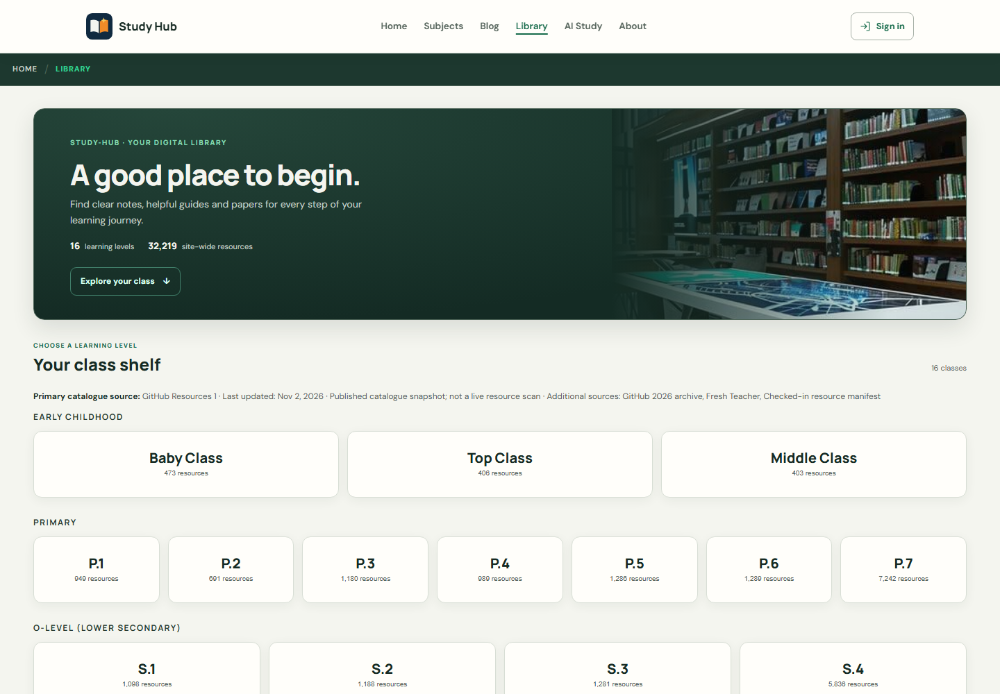
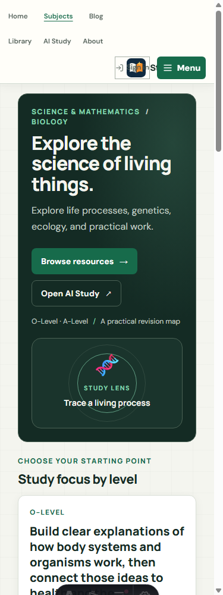
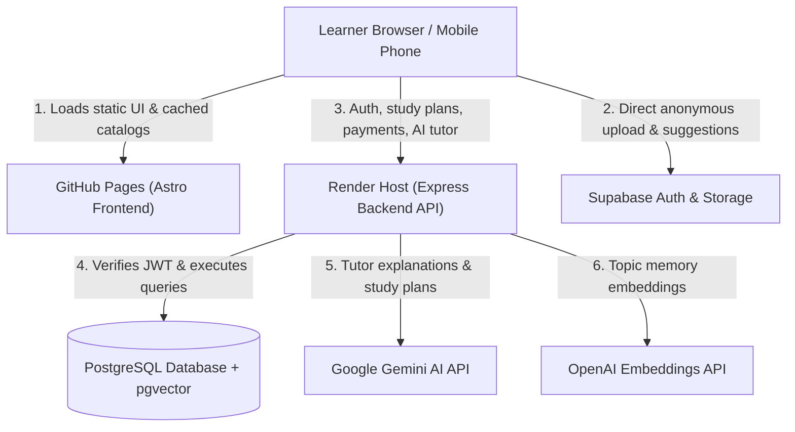

# Study Hub 📚🇺🇬

> A free-to-browse learning platform and AI study assistant tailored for Ugandan students from Primary school through O-Level, A-Level, and University.

[](https://trustjonathan.github.io/STUDY-HUB/)
[](https://github.com/trustjonathan/STUDY-HUB/actions/workflows/ci.yml)
[](https://nodejs.org/)
[](LICENSE)
[](CONTRIBUTING.md)

---

## 🌟 Mission

Quality study notes, revision materials, and examination past papers in Uganda are often expensive, scattered, or trapped behind steep paywalls. **Study Hub** brings curriculum-aligned learning resources directly to students' mobile phones and computers for free.

Visitors can freely browse subjects, read notes in an interactive flipbook reader, and ask AI academic questions—without mandatory sign-ups or subscription fees.

---

## 🌐 Live Platform

- **Production Frontend:** [https://trustjonathan.github.io/STUDY-HUB/](https://trustjonathan.github.io/STUDY-HUB/)
- **Live Subjects:** Biology, Chemistry, Mathematics, Physics, and 24 additional curriculum subjects.
- **AI Study Workspace (PWA):** [https://trustjonathan.github.io/STUDY-HUB/study.html](https://trustjonathan.github.io/STUDY-HUB/study.html)

---

## 📸 Screenshots

| Desktop Library & Reader | Mobile AI Tutor & Subjects |
| :---: | :---: |
| ** | ** |

---

## ✨ Key Features

- **28 Subject Libraries:** Comprehensive notes and UNEB past papers indexed by subject and level (P1–P7, S1–S4, S5–S6, University).
- **Interactive Document Reader:** Custom PDF flipbook viewer with night/warm reading themes, bookmarks, and search.
- **AI Study Assistant (Gemini):** Academic Q&A tutor powered by Google Gemini with automatic model failover.
- **7-Day Personalized Study Plans:** AI-generated study timetables, daily revision tasks, and streak tracking.
- **Topic Memory (pgvector + OpenAI):** Long-term personalized topic recall for registered learners.
- **Optional Accounts:** Sign up with email or Google One Tap (via Supabase Auth) to save bookmarks, ratings, and study history.
- **Anonymous Contributions & Suggestions:** Students and teachers can submit notes and study suggestions without tracking.
- **UGX 1,000 Mobile Money Document Downloads:** Manual verification queue supporting offline document delivery.
- **Offline PWA Shell:** Cached reading interface and study dashboard optimized for low-bandwidth mobile connections.

---

## 🛠 Tech Stack

| Layer | Technology | Hosting / Infrastructure |
| :--- | :--- | :--- |
| **Frontend** | [Astro](https://astro.build/) (v7), React (v19), TypeScript, Tailwind/CSS | GitHub Pages |
| **Backend API** | [Express](https://expressjs.com/) (Node.js), Sequelize ORM | Render |
| **Database & Auth** | PostgreSQL, [Supabase](https://supabase.com/) (Auth, Storage, Edge Functions, pgvector) | Supabase Managed Cloud |
| **AI Integration** | Google Gemini API (`gemini-3.5-flash`), OpenAI Embeddings (`text-embedding-3-small`) | Server-side API proxies |
| **CI / CD** | GitHub Actions | Automated lint, build, test, and deployment |

---

## 🏗 Architecture Overview



For detailed architectural workflows, data flows, and security boundaries, see [docs/ARCHITECTURE.md](docs/ARCHITECTURE.md).

---

## 🚀 Quick Start (Local Development)

### Prerequisites

- **Node.js:** `>=22.12.0` (LTS recommended).
  > **Note:** Astro 7 requires Node 22.12+. Node 20 will cause build failures. Verify your version with `node --version`.
- **Git**

### Option A: Frontend Only (Recommended for New Contributors)

You can run the frontend in less than 2 minutes without setting up a backend or database. Public catalogs and reading modes work out of the box!

```bash
# 1. Clone your fork
git clone https://github.com/<your-username>/STUDY-HUB.git
cd STUDY-HUB/frontend

# 2. Install dependencies
npm ci

# 3. Create your local environment file
cp .env.example .env

# 4. Start the development server
npm run dev
```

Open [http://localhost:4321/STUDY-HUB/](http://localhost:4321/STUDY-HUB/) in your browser.

---

### Option B: Full Stack (Frontend + Backend + Local Database)

To develop authentication, AI tutoring, or payment features:

1. **Start the Express backend:**
   ```bash
   cd ../backend
   npm ci
   cp .env.example .env
   # Edit backend/.env with your local PostgreSQL or Supabase credentials
   npm start
   ```
2. **Run backend tests:**
   ```bash
   npm test
   ```

For comprehensive instructions on setting up a free local Supabase instance, seeding test data, and testing AI flows, see [docs/LOCAL_DEVELOPMENT.md](docs/LOCAL_DEVELOPMENT.md).

---

## 📂 Project Structure

```text
STUDY-HUB/
├── .github/                 # GitHub workflows (CI, Pages deploy, Supabase sync) and issue templates
├── backend/                 # Express REST API, controllers, middleware, and tests
│   ├── api/                 # Route controllers and endpoints
│   ├── database/            # Database configurations, models, and migrations
│   ├── services/            # AI tutors, storage handlers, and monitoring
│   └── test/                # Node test runner unit and integration tests
├── docs/                    # Architecture, deployment, guidelines, and policies
│   └── archive/             # Historical system audits, UI reviews, and mockups
├── frontend/                # Astro 7 frontend application
│   ├── public/              # Static assets, manifests, and catalogs
│   └── src/                 # Astro pages, React components, layouts, and styles
├── full_page_flipbook_viewer/ # Standalone flipbook reader engine
└── supabase/                # Supabase configurations, SQL migrations, and Edge Functions
```

---

## 📖 Documentation Index

- 🏛 **[Architecture & Data Flow](docs/ARCHITECTURE.md)**
- 💻 **[Local Development & Testing](docs/LOCAL_DEVELOPMENT.md)**
- 🤝 **[Collaboration & Governance Policy](docs/COLLABORATION_POLICY.md)**
- 🔍 **[Code Review Guidelines](docs/CODE_REVIEW_GUIDELINES.md)**
- 🚀 **[Deployment Runbook](docs/DEPLOYMENT.md)**
- 🔐 **[Secrets & Environment Variables](docs/SECRETS_AND_ENV.md)**
- 🗄 **[Database & Migrations Guide](docs/DATABASE_AND_MIGRATIONS.md)**
- 📝 **[Content & Revision Guidelines](docs/CONTENT_GUIDELINES.md)**
- 🛡 **[Repository Settings Checklist](docs/REPO_SETTINGS_CHECKLIST.md)**
- 📊 **[System Audit Report](AUDIT_REPORT.md)**
- 📋 **[Issues Backlog & Roadmap](ISSUES_BACKLOG.md)**

---

## 🤝 Contributing

We warmly welcome contributions from students, educators, and software developers across Uganda, East Africa, and the world! Whether you are fixing a CSS bug, adding revision notes, or improving documentation, your help is appreciated.

Please read our **[CONTRIBUTING.md](CONTRIBUTING.md)** and **[CODE_OF_CONDUCT.md](CODE_OF_CONDUCT.md)** before opening a pull request.

---

## 📄 License

- **Source Code:** Released under the [MIT License](LICENSE).
- **Curriculum & Study Materials:** All uploaded educational notes, past examination papers, syllabi, and diagrams belong to their respective copyright holders, schools, or UNEB. See [docs/CONTENT_GUIDELINES.md](docs/CONTENT_GUIDELINES.md) and [LICENSE](LICENSE).

---

## 📬 Contact & Support

- **Project Maintainer:** Jonathan Mwesigwa ([@trustjonathan](https://github.com/trustjonathan))
- **Email:** [trusteth777@gmail.com](mailto:trusteth777@gmail.com)
- **Security Inquiries:** See [SECURITY.md](SECURITY.md)
