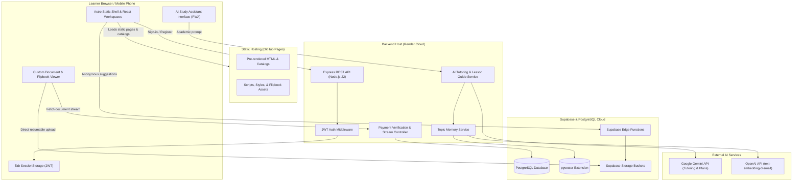
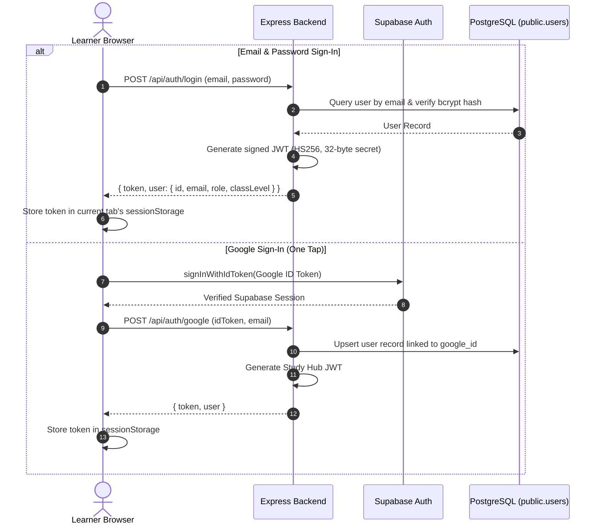
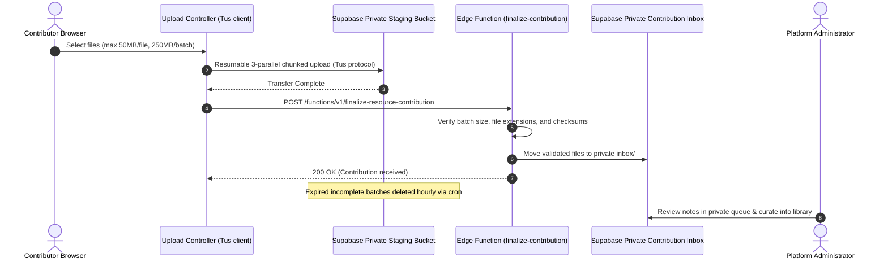
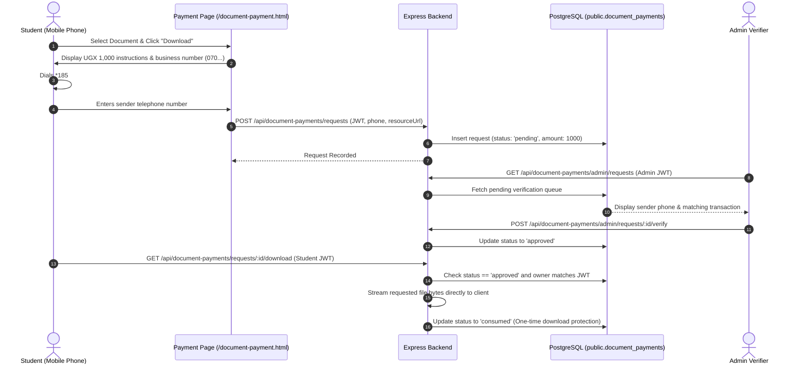
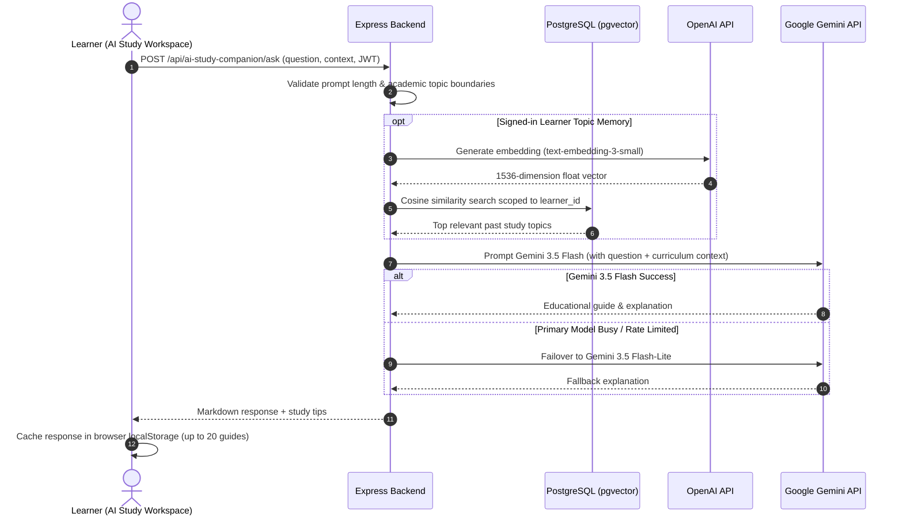

# Study Hub Architecture & Data Flow 🏛

This document outlines the technical architecture, data flow pipelines, security boundaries, and external integration points of Study Hub.

---

## 1. High-Level System Architecture

Study Hub is built with a decoupled architecture designed to deliver fast static content over low-bandwidth cellular networks while supporting rich interactive learning tools.

---

## 2. Authentication & Session Flow

Study Hub offers browsing and reading without an account. For saved bookmarks, ratings, and personalized AI memory, optional accounts are supported.

### Security Properties
- **No Third-Party Cookies:** Token is stored in `sessionStorage`, isolating sessions per browser tab and bypassing cross-site cookie restrictions.
- **Client ID Isolation:** The Google Client ID is public in the frontend; the Google Client Secret remains strictly inside Supabase Auth dashboard.

---

## 3. Resource Contribution & Staging Flow

Learners and educators can submit revision notes anonymously. To protect the public catalog from spam and malicious uploads, files land in an isolated staging bucket before manual review.

---

## 4. Document Payment & One-Time Download Flow

Study Hub provides an optional offline download pipeline for students who need physical printing or offline revision, funded by a nominal UGX 1,000 Mobile Money fee.

---

## 5. AI Tutoring, Study Planning & Vector Memory Flow

Study Hub integrates Google Gemini for academic tutoring and OpenAI embeddings + pgvector for long-term memory.

